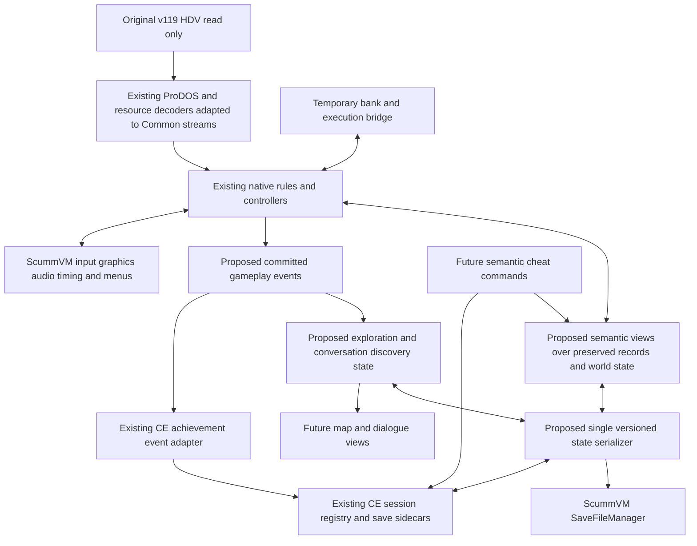

# Nox Archaist architecture decision and ScummVM CE migration

Assessment date: October 15, 2026, America/Los_Angeles. Scope: original base game v119 on Windows x64 through ScummVM Comfort Edition. Lord of Storms is deferred.

## Decision

**Adopt approach D: integrate the existing implementation into CE early, retain a clearly bounded compatibility runtime during migration, and replace execution coupling with semantic gameplay operations where that removes actual dependencies. Preserve the native algorithms, data readers, record formats, rendering work, and behavioral oracles. Stop treating translation coverage as the delivery objective.**

The native conversion was a useful investment. It has recovered substantial behavior and provides unusually strong comparison infrastructure. However, “native” currently describes several different things: independent resource/record algorithms, compiled controllers that still use a machine ABI, and even compiled single-instruction dispatch. They have different reuse costs and different value to the final engine.

The evidence supports diminishing returns from continuing hardware-accurate conversion as the default priority. The latest work queue explicitly prioritizes code ownership over longer quest journeys. Its next task is preserving IRQ windows through gameplay continuations. Meanwhile, no CE engine exists here, normal saves are not persisted when the game reports them complete, and mandatory campaign completion remains unverified. These are more consequential uncertainties than the remaining dispatch count. This does **not** mean IRQ guards can safely be deleted or that every remaining instruction is irrelevant.

The first implementation decision should be an integration experiment with a playable state, two isolated Play Sessions, and a durable save round-trip. That establishes the destination before more conversion work is approved. The final release must run without general original-instruction interpretation; the first integration experiment need not.

## Evidence and source conventions

The source tree, not its progress documents, controls implementation claims. Historical validation reports establish only their recorded scenarios and executable identities. New read-only checks below were run against existing binaries; no production source was changed or rebuilt for this assessment.

Paths beginning `conversion/` resolve beneath `D:\Codex Projects\Nox Archaist`. CE paths resolve beneath `D:\Codex Projects\scummvm-private\scummvm-private-feature-usable-desktop-window-layout-git`. Website paths resolve beneath `D:\Codex Projects\CE Achievements`. The source reference appendix supplies clickable absolute paths and function anchors.

The inspected CE checkout is clean on `main`, at commit `5f84c5cd08cbc54083cf72da8cfa1665294c2bca`. No remote refresh was needed to assess its local APIs; this is not a claim about the latest remote revision.

The current `conversion/build/Release/nox_live.exe` SHA-256 is `d26b2e8dd19efc1420ae569892f8ae3bd6f39f06cbfd835758f95cfdd1e0d695`. It matches `execution-audit-verification.json`, `remaining-execution-verification.json`, and `native-music-live-verification.json`. The original v119 HDV SHA-256 is `c42a95c7a356548c78957f98693e92d33c9bae3ff5126d9887c2980e5a490c3c`.

### A Current architecture inventory

| Component and actual source | What exists | Completeness and dependency | Reuse decision |
| --- | --- | --- | --- |
| `live_port.c` | WinMain, Windows messages, CPU scheduling, framebuffer conversion, dispatch, diagnostics, session-image lifecycle | A functioning standalone host, not an Engine subclass; tightly coupled to Win32 and global machine state | Extract runtime orchestration and pixel conversion; replace host calls with CE services |
| `banked_runtime.c`, `banked_live.inc` | Main/aux RAM, language-card banks, CPU registers/stack/flags, bank switches, original code dispatch | Still authoritative for execution context; generated translated code remains in ordinary runs | Temporary compatibility context and reference oracle, not final engine architecture |
| `banked_fallback.inc` | General 65C02 opcode execution and instruction lengths | `fallback_step()` decodes original bytes; unsupported stop instructions fail rather than silently succeed | Keep in development reference/bridge builds; remove from release runtime |
| `native/hdv_archive.{h,cpp}` | ProDOS directory/block parser; seedling/sapling/tree files; named resources; allocated padding preservation | Strongly reusable format logic; throws exceptions and uses C++20 spans; also contains host filesystem discovery and mutable session support | Preserve parser and range rules; move discovery to Common filesystem; split immutable source from mutable overlay |
| `native/bridge.{h,cpp}` | C boundary for resources, map queries, traversal, dialogue, events, storage | Useful boundary, but process-global resource pointer, caches, journal and event queue; not per-engine state | Preserve operations; make ownership explicit and clear/reset on session transitions |
| `native/party.{h,cpp}`, `equipment.{h,cpp}` | Lossless records; health/damage; roster read; progression arithmetic; item fields; readiness and weight rules | Independent semantic pieces exist, but full party/inventory orchestration still uses bank/frame controllers | High algorithm reuse; add semantic accessors around preserved records, not replacement records |
| `native/gameplay.cpp` and its included controller programs | Party membership, inventory/equipment, commands, conversation, combat, quests, presentation, actor and world controllers | Native compiled behavior for verified contexts; many stages take `NoxGameplayFrame`/`NoxBankFrame`, recognize bytes/PCs and return to original addresses | Preserve verified behavior and tests; selectively remove ABI dependence at complete gameplay operations |
| `native/quest_services.cpp`, quest/progression programs included by gameplay | Service return, NPC awards, search/pickup, key predicates, commerce/training/temple behavior | No standalone complete campaign model; shared return itself pushes a machine stack and sets PC; actual progression depends on resource predicates | Reuse predicates and transactions; expose outcomes and persistent flags through semantic operations |
| `native/dialogue.cpp`, `dialogue_packets.cpp`, `dialogue_loader.cpp` | Packet decompression/selection, keyword matching, aliases/stems, substitutions, condition processing | Strong format and behavior coverage; many text operations deliberately use a 64K layout; dynamic effects still use controllers | Preserve original mechanics; wrap conversation actions and resulting effects |
| `native/conversation_journal.{h,cpp}` | Stable resource/record identity, replies, discovered/used keywords, search, response events, JSON export | Already distinguishes authored matching data from discoveries; no load/deserialization API in the inspected header | Excellent dialogue-map foundation; add versioned persistence and reset/restore lifecycle |
| `native/map_catalog`, `compressed_map`, `local_map`, `location_resources`, `map_projection` | Surface/combined/underworld resource handling, local 48×48 maps, metadata, decoded sectors, live-cache projection | Native map content exists; generic exploration history, annotations and semantic transition catalog are not established | Preserve formats; introduce stable location/cell identities and discovery state |
| `native/movement`, `movement_action`, `traversal`, `world_effects`, `world_events` | Position/camera/sector updates, blocking reasons, scripted interaction decisions, clocks, completed turn/location events | Useful semantic calculations; integration observers still sample machine state; events do not cover every quest/combat/item commit | Reuse, then publish events from committed operations |
| Native presentation/scene/viewport programs, `font_bridge.cpp` | Text/input, glyphs, tiles, visibility, planes, actors and framebuffer behavior | Native raster/controller work still operates on legacy display banks and flags; Windows presentation is separate | Preserve raster results and coordinates; submit pixels through CE |
| `native/music.cpp`, `music_program.inc`, `native_music.inc`, `speaker_audio.c`, `mockingboard.c`, `live_audio.inc` | Compiled music installer/sequencer/stubs, speaker and PSG synthesis, waveOut host playback | Music code still dispatches by physical bank/PC and reproduces CPU flags; native gameplay may decline near IRQs; waveOut is Windows-specific | Preserve synthesis and sequencing behavior; replace waveOut with Audio::Mixer and eventually decouple sequencing from CPU IRQ delivery |
| `native/save_records.h`, `game_storage.h`, `native_save.inc`, storage/location I/O | Opaque field-preserving pack/unpack, legacy slot handling, inn inventory, mutable map storage | Legacy two-slot layout and in-memory HDV writes; not a durable unified CE serializer | Preserve record knowledge; replace persistence and UI entry routing |
| `check_*.c/.cpp`, Python comparison runners, JSON reports | Instruction/stage comparisons, atomic rejection checks, whole-call contracts, bank/frame/audio and cold-load comparisons | Valuable but fixture-specific; some scenarios inject state; earned reports are older than current executable | Keep as regression oracles; add CE behavioral acceptance rather than expanding address queues |

**Complete versus partial:** the parser, individual arithmetic/record operations, specified packet codecs and tested transfer shapes are implemented operations. “Combat exists” or “dialogue exists” does not establish all campaign contexts, branches or completion. No inspected evidence establishes the complete game as a native, independently scheduled system.

#### Actual execution dependency

`live_port.c:295` tries observers and fixtures, then many guarded native adapters, then host routines, `translated_step()` at line 360, then `fallback_step()` at line 362. `step_machine()` adds trace/scheduling behavior around this body; timing and Mockingboard advancement continue around dispatched work. `banked_runtime.c` includes generated `banked_live.inc` in the live configuration.

The latest recorded dispatch totals are:

| Profile | Generated translated visits | Fallback visits |
| --- | ---: | ---: |
| Dialogue | 1,898 | 1,718 |
| Cold load and inn | 308 | 333 |
| Travel | 2,728 | 1,073 |
| Equipment | 1,999 | 763 |
| Dialogue with music | 378,687 | 8,428 |
| Travel with music | 542,869 | 53,008 |

These are successful dispatcher visits, not features, instructions in the source, CPU cycles, unique PCs or percentages. Native blocks coalesce instructions; native music can still dispatch one compiled instruction at a time. Music changes the counts dramatically without implying a similarly dramatic difference in missing gameplay.

There are three reasons compatibility cannot simply be removed today:

1. Accepted native controllers still communicate through registers, return PCs, stacks and bank state.
2. A controller may decline a context or timing window, and original execution then supplies the behavior.
3. Unvisited campaign branches have not established either complete native coverage or the required semantic replacement.

The first two are confirmed from source. The third is an unbounded coverage uncertainty, not proof that the ending is absent.

### Correcting execution measurement

**Confirmed defect:** `execution_audit.inc::audit_capture()` currently records only the bytes belonging to the actual instruction using `fallback_length` and side-effect-free `timing_peek`. Its schema is 2. However, `audit_remaining_execution.py` builds several resource signature dictionaries from `data[offset:offset+3]` and compares those full integers to the normalized recorded value. This affects resident setup, inventory and command attribution patterns. Music classification already uses a length mask.

A read-only recalculation against the current stored audit and extracted v119 resource bytes reproduced the problem for resident setup:

| Profile | Existing fixed-three-byte matches | Instruction-length-masked matches |
| --- | ---: | ---: |
| Dialogue with music | 23 | 93 |
| Travel with music | 356 | 975 |

Example: physical bank 8, PC `$FD3C`, instruction length 2, records `$00E8B1`; the three-byte resource sample is `$30E8B1`. At `$F768`, a two-byte branch records `$000CF0` while the resource sample is `$A90CF0`. The third byte belongs to the following instruction. All four nonmusic resident-setup profiles remain zero under this particular masking recalculation. These results count both translated and fallback visits and demonstrate missed attribution; they do not prove ownership of every reused overlay or validate other zero claims.

**Correct measurement contract for the next implementation milestone:**

- Report generated dispatch and fallback dispatch separately, plus total original-execution visits. Record failed/unsupported dispatch attempts separately from successful visits.
- Canonicalize both expected and observed instruction bytes with the same verified opcode length and byte order. Preserve raw bytes for diagnosis. Never match trailing bytes from another instruction.
- Key unique addresses by physical storage, mapped resource/overlay identity and load epoch, then PC. A PC alone is not a routine identity; the same bank/address may contain different programs.
- Identify routines from resource-relative entry points and call/continuation context. Report known routines and unresolved ownership separately. Do not label each unique PC a routine.
- Distinguish an adapter being inapplicable from rejecting an operation it claims to own. Record owner, reason and unchanged-state guarantee for supported-PC declines: disabled, identity mismatch, unsupported mapping, invalid pointer/stack, unsupported service, IRQ deadline, or actual unimplemented branch.
- Classify confirmed dependencies as gameplay, resource format, presentation/audio, hardware mechanism, scheduling/ABI coupling, or unknown. One reason can have many visits; a rare campaign branch can be more important than a busy poll.
- Require zero dropped records, reconciliation of per-stage and per-kind totals, fixture provenance, executable/resource hashes and instrumentation on/off parity. Keep the existing 205-file parity method where appropriate.
- Add classifier regression examples for one-, two- and three-byte instructions, patched operands, adjacent mutable bytes and overlay reuse. A mask fixes the signature bug; resource identity is still needed to fix false attribution.

No production instrumentation change or new conversion queue is part of this assessment. Final confidence must include an interpreter-disabled build, not merely a better zero counter.

## B Strategy comparison

| Criterion | A Finish translation first | B Integrate current runtime now | C Replace at a higher level first | D Integrate and replace selectively |
| --- | --- | --- | --- | --- |
| Engineering effort | Unbounded before integration because branch coverage is unknown | Bounded first experiment; later debt remains | High initial behavior recovery/rewrite cost | Bounded integration experiment, then outcome-based work |
| Main risk | Hardware/ABI conversion expands indefinitely; destination problems arrive late | Compatibility bridge becomes permanent | Regressions in working behavior and data semantics | Requires firm exit criteria and controlled bridge ownership |
| Reuse | High code reuse; some work later discarded with hardware scaffolding | High | Selective; risks discarding valuable controllers | High algorithms, formats, tests; selective controller replacement |
| Maintainability | Large PC/state-machine surface | Initially poor if merely copied as a monolith | Good potential, uncertain time to parity | Improves at the interfaces needed for saves and enhancements |
| Performance | Native labels do not eliminate tiny dispatch overhead | Enough to validate; measure actual CE frame/audio behavior | Potentially best, unmeasured | Remove hot coupling where it matters; no speculative performance promise |
| ScummVM fit | C++/host/save issues deferred | Exposes incompatibilities immediately | Risks building another host framework | Uses CE services from the first milestone |
| Testability | Strong equivalence, weak campaign proof if routes remain short | Actual destination becomes testable | High-level tests need recovered behavior oracles | Existing equivalence plus earned CE campaign evidence |
| Enhancement support | Memory/PC ABI survives unless separately addressed | Thin wrappers alone insufficient | Strong semantic foundation | Semantic wrappers introduced around real transactions |
| Long-term debt | Large generated instruction-derived controllers | Entire bridge can become lasting debt | Reimplementation and duplicate models | Temporary bridge plus explicit retirement gates |

**Choose D.** B is the first action within it. Use C selectively for scheduler, save transactions and gameplay operations whose machine coupling blocks progress. A remains useful for a small verified gap when it is cheaper than replacing the containing operation, but is no longer the governing strategy.

Do not promise a percentage of reusable source lines. Most resource/format knowledge and much native behavior are reusable; significantly less of the Windows host and instruction-level control model belongs in the final engine.

## C Proposed target architecture

The following names describe responsibilities, not required classes. Components marked proposed do not currently exist as complete services.

Keep original byte layouts internally where lossless records simplify verification. Place a small, typed API between those records and enhancement consumers. For example: read party members and health; transact inventory changes; apply gold changes with bounds; query location/terrain/traversal; evaluate quest predicates; commit dialogue effects. Centralize offsets in these services and format codecs. Do not scatter raw addresses into CE GUI or achievement code.

Emit events **after** a successful transaction or player-observed completion boundary. Item acquisition is not a resource load; a quest is not complete because a prerequisite flag was set. Use stable resource-qualified identities and a cause such as earned, loaded or assisted. Reloading state must not replay awards as newly earned events. Save event/discovery sequence state where needed to prevent duplicate consumption, while leaving the CE network queue's immutable identity under CE ownership.

Existing `WorldEvents` already describes completed turns, interactions and settled locations. Existing journal response events are also useful. Neither establishes a comprehensive quest/boss/recruitment/completion event system. Add only events supported by verified gameplay boundaries; do not invent achievement identifiers or genericize every memory write.

### CE engine and host services

Use normal `engines/nox/` registration: `configure.engine`, `module.mk`, detection translation unit/table, metaengine and plugin registration, plus an `Engine` subclass. Follow the local MacVenture detection/metaengine pattern and the CE build generator. Add the engine to this fork's actual Windows generation/build selection. The existing standalone CMake targets are test/reference tools, not the final build system.

| Requirement | Local CE integration contract |
| --- | --- |
| Detection | Advanced detector for supported v119 resources; structural fallback only when it can identify the exact supported layout |
| Resources | Common::File/SeekableReadStream, SearchMan or Common filesystem for user-owned HDV; retain validated ProDOS parsing and bounds |
| Startup | Engine::run initializes per-instance state/resources, honors requested startup save, then enters bounded updates |
| Frame presentation | Existing pixel generation into Graphics::Surface or ManagedSurface; initGraphics and OSystem copyRectToScreen/updateScreen |
| Input | EventManager polling plus MetaEngine::initKeymaps and Common::Keymap actions; preserve original text/arrow/modal semantics |
| Scheduling | Bounded runtime slices and getMillis/delayMillis for host pacing; poll quit/menu events without blocking inside a wait loop |
| Audio | Audio::AudioStream/queue or pull stream through Audio::Mixer; retain speaker/AY synthesis; pause and flush appropriately on load |
| Options | Local ADExtraGuiOptionsMap and ConfMan; mark actual cheat options with kExtraGuiOptionFlagCheat |
| Save/load | Engine save/load entry points and MetaEngine enumeration/metadata/deletion, all routed to one serializer and slot resolver |
| Launcher/menu | Normal ScummVM launcher, global menu and save chooser; original classic UI is another caller of the same service |
| Sessions/achievements | Common::CEAchievements lifecycle, popup-state sidecars and recordSave hooks; gameplay event adapter rather than HTTP in rules |

`live_audio.inc` uses waveOutOpen/Write/Reset; `live_port.c` uses WinMain, SendMessage, timers, GDI presentation, MessageBox, MoveFileEx and native output paths. Those calls do not belong in `engines/nox`. The synthesis code and useful pixel conversions can survive after host calls are removed. Diagnostic fixture input using Windows messages remains a standalone oracle; CE tests must inject ordinary CE events or player input.

### C++11 and library compatibility

`conversion/CMakeLists.txt` requires C++20. Real incompatibilities include pervasive `std::span`, string `starts_with`, `std::string_view`, `std::filesystem`, `std::make_unique` and structured bindings in utility code. `bridge.cpp` and parser code also use exceptions and standard-library containers; CE's create_project setup includes a no-exceptions configuration. Changing only the CMake standard does not solve these issues.

Use CE's existing Common::Span, Common strings/containers and streams where practical, with a small local C++11-compatible view only if Common::Span's semantics do not directly fit. Replace parser exceptions with explicit recoverable errors at resource boundaries. Convert filesystem discovery to Common filesystem. Leave standalone extraction/research programs on C++20 if useful; they are not engine dependencies. Move C-oriented adapter files to C++ translation units as needed without changing their behavior.

Do not raise ScummVM's global standard or introduce a prebuilt Windows-only C++20 DLL. The C bridge demonstrates a useful separation but does not make a separately compiled C++20 library portable or compatible with CE's build/error conventions. Compile a small resource-plus-record slice under the actual CE toolchain before estimating the whole port.

### Resource identity and immutability

The current `findGameImage()` scans HDVs and can be ambiguous when base and expansion images coexist. `nox_runtime_compatible()` checks the v119 `LOADER.P` length of 10,514 bytes; that is a runtime layout guard, not sufficient game detection by itself.

Use the original image as immutable input. Detect with stable original-resource signatures and structural/layout checks; do not let mutable original save sectors invalidate otherwise valid user-owned v119 media. A full-image hash is excellent evidence for this assessment's exact image, but should not be the only distribution-wide detection rule. Preserve allocated padding behavior that current readers intentionally use. Explicitly reject unsupported expansion layouts rather than accidentally launching them as v119.

During the bridge period, intercept named storage and legacy block writes into a per-session overlay. Preserve a full private image only as a temporary implementation detail if necessary. At a save boundary, serialize the current world and all mutable resource deltas; never persist changes to the source HDV. A user's original disk-image saves may later be imported explicitly, but are not the normal save backend.

## D Unified save and Play Session architecture

### What CE already does

The launcher creates a `clientPlaythroughId` with `startPlaythroughForTarget()`. The service persists `CEPlaythroughRecord` entries in its shared registry and maintains active target/game/variant/client/server identity. The website assigns the server playthrough identity. Save association is held in `<actual-save-filename>.ce-achievements.json` through shared service methods.

Loading a tracked save calls `recordSaveLoaded()`, which activates the recorded session. It does not create a new playthrough merely because the save is earlier. Missing sidecar identity currently clears active tracking. `loadPopupStateForSave()` restores save-associated popup/progress state. Follow the explicit Cine/MacVenture patterns; do not confuse the base Engine's recordSave hooks with complete popup-state handling.

The CE chooser lists sessions, filters saves by their sidecars, switches the load filter, and offers completed/abandoned/archive/delete actions. **Filtering is not storage isolation.** Cine/MacVenture examples establish association and lifecycle, but do not by themselves guarantee that two Nox sessions can safely write the same physical slot filename.

The inspected fork also has a useful additional precedent: Grim's `ce_emi_windows_saves.h` uses target/session-specific filenames, retains native slot numbering, and maps chooser entries back to actual files. Reuse that principle for Nox's two classic slots while continuing to use the common CE session registry. Do not copy MI4's native save format, 160-slot count, or metadata-specific assumptions.

### One serializer and two interfaces

Both original in-game Save/Load and ScummVM Save/Load must invoke:

`resolve session and slot → validate save eligibility → capture complete state → serialize/commit or validate/restore → update CE metadata`.

There is no separate authoritative HDV save and no second enhancement-state serializer. Legacy pack/unpack routines are codecs within this operation. Serialize enhancement state in the same payload as gameplay state; shared CE sidecars remain CE-owned lifecycle/achievement metadata, not a second copy of the Nox world.

Save at a quiescent gameplay/modal boundary where capture is defined. During migration, restrict menu saves to those boundaries and report a clear unavailable reason. Do not advertise arbitrary mid-instruction saving. A loading operation builds and validates candidate state before replacing the live world; invalid loads must leave the current game intact.

### Slot namespace and session isolation

Use a physical key `(target identity, CE clientPlaythroughId, logical slot)`. Use flat, escaped or hashed filenames because SaveFileManager does not support directories. Store the full target/session identity in the payload and verify it; filename hashes alone do not establish ownership. The CE session ID is the existing ID, not a Nox-generated replacement.

| Mode | Player-visible logical slots | Policy shared by both interfaces |
| --- | --- | --- |
| Modern | Multiple numbered slots, at least 0–999 as an initial supported range | Descriptions, thumbnails/metadata and overwrite/delete; in-game Save/Load opens or delegates to the modern chooser |
| Classic | Exactly 1 and 2 per Play Session | In-game labels 1/2 and CE chooser resolve to the same two logical saves; reject any other save request |

Classic's labels need not equal the integers returned by the all-session load chooser. MetaEngine::listSaves produces deterministic chooser handles mapped to actual files across sessions; getSavegameFile, querySaveMetaInfos and removeSaveState must use the same mapping. The current Grim implementation demonstrates this distinction. Resolve a handle to `(session, logical slot, actual filename)` once before I/O and keep it stable for the operation. Refresh mappings after creation/deletion, never during a pending operation.

For active-session saving, the chooser must expose exactly the permitted logical slots, including empty ones. The existing generic chooser's available-slot construction must be exercised: overriding only getMaximumSaveSlot is insufficient because its signature is not per session and cross-session load handles can exceed two. If engine enumeration/descriptor policy cannot restrict empty entries consistently, add a narrow shared save-slot-policy hook used by the chooser and the Nox save entry point. This is a justified CE integration change, not a new session framework. No unrelated GUI refactoring is required.

Disable autosave, quicksave outside the two slots, save-before-load and exit autosave in Classic mode through the engine/metaengine policy. In Modern mode either reserve a separate per-session autosave slot and expose it consistently or initially disable autosave until tested. Match Engine and MetaEngine autosave slot behavior. Do not allow a global autosave filename to cross sessions.

Persist save mode with each session's saved state and establish it at new-session creation. A load restores the saved mode. Do not silently reinterpret existing modern saves by toggling a global checkbox; a later explicit conversion may preserve source saves and clearly select the destination slots.

### Complete serialized state

| State | Required representation |
| --- | --- |
| Party/companions | Character and companion records, ordering, membership, health/magic/status, practice/experience and opaque bytes |
| Inventory/equipment | Carried/ready items, quantities, gold, cached persistent ownership and inn storage; preserve sentinel/padding semantics |
| Quests/NPCs/dialogue | Flags, counters, object states, persistent NPC schedules/changes and completed dialogue effects |
| World/maps | Modified sectors/objects, mutable resource deltas, current location/level, transitions, vehicles and positions |
| Simulation | RNG state, world clock and pending semantic continuation needed to resume deterministically |
| Bridge state while needed | All authoritative banks, CPU/mapping state, loader/resource cursors, mutable disk overlay, relevant timers/interrupt state and controller continuation, or a proven normalized boundary that reconstructs them |
| Enhancements | Explored/visible knowledge, discovered transitions, annotations, conversation history/discovered/used topics and future persistent settings/data |
| Identity/provenance | Resource variant/fingerprint, schema version, CE client session identity, logical slot, save mode and generation; assistance metadata follows CE conventions |

`SaveRecords` knows about opaque save trailers and copies selected fields; it is not proof that its current two legacy records cover all modern engine state. Audit every mutable owner, especially archive private copies versus the session disk, journal/event queues and active map caches. Derived caches may be rebuilt, but their reconstruction must be tested. Do not save only the currently visible map or currently loaded NPCs.

Use explicit field encoding and byte order, a magic, format version, resource compatibility identity, bounded chunk lengths, checksums and a completion marker. Never dump C++ object memory or pointers. Keep opaque legacy chunks versioned until their meaning can be removed safely. Optional future chunks can be skipped; unknown mandatory versions are rejected. Migrate older schemas through explicit readers and retain fixtures for every released format. Compatibility bridge snapshots can be an explicitly temporary schema; do not accidentally promise indefinite support for every development snapshot.

### Durability and error handling

**Confirmed current problem:** `live_port.c::dump()` writes the private session image via a temporary file and MoveFileEx on dump/close. Ordinary legacy save writes update memory through GameStorage/session blocks. A completed in-game save therefore does not guarantee persistent data until a later dump or normal exit. The source image is opened read-only; the durability defect does not imply normal saving writes the source HDV.

**Confirmed CE limitation relevant to the design:** DefaultSaveFileManager::openForSaving uses `createWriteStream(false)`. SaveFileManager::renameSavefile is implemented as copy then remove. Do not assume these APIs provide atomic replacement. The MacVenture example also warns on finalization error but returns success; copy its integration pattern, not that error behavior. The base Engine implementation does not by itself provide all needed stream-finalization checks either.

For the initial Windows destination, use one logical save with two internal generations through SaveFileManager. Write the inactive generation with a monotonic sequence, payload checksum and final completion marker; finalize, check errors and reopen/validate before acknowledging success. Retain the previous valid generation. Enumeration exposes only one logical slot and resolves its highest valid complete generation. An interrupted write leaves the previous generation loadable. These are two durability copies of the same serialized save, not two gameplay save systems or two extra classic player slots.

Resolve the actual generation filename before calling CE popup and recordSave hooks. Enumeration, sidecar lookup and deletion must agree on that filename. Remove both generations and their sidecars on logical deletion. Treat orphan/incomplete files as recovery candidates, never additional player saves. A crash between payload commit and CE sidecar creation needs explicit recovery: the payload preserves the session association, but CE must conservatively repair/recognize metadata through a shared import/recovery path or expose it as untracked/unknown history. Never silently award verified status from an unsigned payload field. CE sidecar APIs currently return void for several operations, so metadata failure cannot simply be inferred from their return values.

This scheme protects against interrupted overwrite and process crashes; it does not imply a portable SaveFileManager fsync or absolute power-loss guarantee. Test the actual Windows backend and report its guarantee accurately. Any stronger backend flush requirement should be a small shared backend change, not engine-local Win32 file I/O.

### Sessions and assisted play

Reset all mutable engine owners when starting a new session or switching through a load, including original-memory banks, mutable resource overlays, map caches, journal, discovery state and event consumers. New sessions start from immutable new-game resources, not the previous session image or source GAME1/GAME2 contents. Loading earlier saves rolls Nox world/discovery state back to that save. CE's run-level history and permanent casual classification must not roll back with it.

Use `shouldApplyCheat()` and `noteDisqualifyingAssistance()` plus existing cheat option flags. One-time semantic cheat commands also mark assistance when applied. CE already owns casual/assisted/tainted history; do not add a Nox leaderboard classification. A clean new session must not inherit a previous run's cheat effects. If disqualifying options remain enabled globally, follow CE's existing startup classification rather than representing the new session as clean.

Deletion without deleting saves intentionally produces untracked saves under current CE semantics. Preserve that option and handle it conservatively on load. Deletion with saves removes all Nox slot generations and sidecars through engine enumeration. Session switching is loading a selected session's save; choosing a filter alone must not swap a running world.

### Achievements with zero definitions

Reuse `noteCEGameEvent`/`noteGameEvent`, `unlock`, CE's durable signed queue, immutable event IDs, run-scoped submission and website endpoints. Keep CE transport out of gameplay logic. Popup suppression and lifetime award deduplication are distinct from repeated achievement events in another playthrough.

**A small shared change is required:** launcher.cpp currently calls `hasAchievementSupport()` and clears game/variant if no catalog definition exists. `startPlaythroughForTarget()` itself only requires target, and sync eligibility requires game, variant and token. Local sessions can exist without achievements today; Nox website session tracking with zero definitions would be disabled by this launcher gate. Separate session/API capability from achievement-catalog presence, preserving non-supported-game behavior. No placeholder achievements are needed.

The local website PlaythroughController validates an existing game slug and variant, then creates a playthrough without requiring an achievement. The existing POST/PATCH playthrough, event and save routes suffice. Register the agreed Nox game/variant metadata if absent; no Nox seeder was found in the inspected seeders. Exact external identifiers must be coordinated with the existing catalog/API, not invented in this document. Verify deployed registration later with the dedicated test account. The public website could not be read through the web tool in this assessment; the local API source establishes the contract, not live deployment readiness.

CE queueing and activation have real lifecycle conditions: do not assume an offline-created session automatically becomes sync eligible merely because a token is added later. Use current service rules and exercise offline start, delayed server start, save/load, retry and token changes explicitly. Preserve immutable queued payloads when linking start responses and future achievement events.

## Enhancement interfaces

### Automapping and exploration

Separate immutable terrain/content, mutable world changes, current visibility, discovered knowledge and cheat reveal. Existing maps expose tiles, metadata and resource/map IDs; traversal supplies semantic blocking reasons and scripted interaction requirements; world snapshots supply map type, coordinates and time. Surface sectors, local 48×48 maps and underworld levels must retain distinct coordinate/identity rules.

Proposed read interfaces return location/level identity, tile/terrain, current obstacles, transitions, vehicle/player position and visibility. Discovery is updated only from actual visibility/entry rules and settled transitions, not from decoding a whole resource. Store explored cells and discovered transitions with resource-qualified keys. A reveal-all cheat changes the display/reveal state and assisted provenance without falsely claiming every location was naturally visited. Keep future labels, points of interest and annotations in the same versioned enhancement chunk; do not build the UI now.

### Dialogue mapping

Preserve the journal's `resource#record` identity, original actor information, matched stem/alias, input, selected keyword, response and recognized/opening flags. Retain discovered-versus-used topics; authored packets remain private matching data. The existing tests explicitly keep hidden topics out of search/export until discovered.

The current journal is enough to begin a useful discovered-conversation view. It is not a complete authored dialogue graph: quest predicates, voice-dependent alternatives and effects are executed dynamically, and a keyword's appearance in a response does not establish every NPC relationship. Add stable response/condition provenance where actually available. Record what was observed, not hypothetical reachable replies. Add deserialize/restore and session reset. Restore an earlier save's history by default, consistent with that save's world; a future session-wide notebook would need an explicit policy rather than accidental merging.

### Cheats and gameplay events

Expose semantic commands for gold/stat/item changes, healing, map reveal and later quest/world changes, with bounds and invalidation in one owner. Keep original byte layouts behind those commands. Existing party/equipment methods are a useful start but not a complete cheat API; NPC/quest/combat/world mutations need stable access before external enhancement code uses them.

Future event consumers can share successful acquisition, recruitment, quest completion, combat result, character advancement and final completion boundaries. They must not use a guessed “ending address” or assume an early encounter prerequisite is completion. Future achievement definitions remain separate work.

## Campaign coverage and acceptance

### Evidence ledger

| Evidence | Provenance and what it establishes | What it does not establish |
| --- | --- | --- |
| Current execution/music reports | Current executable hash; six profiled routes; on/off audit parity reports 205 identical files; music live report 12 processes, four cold loads and 55 exact frames | Entire campaign, all contexts, or reliable routine attribution in fixed-three-byte classifiers |
| `progression-live-verification.json` | Older executable `3bdaa37e…`; 16 processes, 852 exact frames/checkpoints, 12 cold loads; runner drives ordinary input for Log acquisition/repeat/reaction | Latest-build regression or campaign completion; the prose note's 848 count is superseded by the actual report's 852 |
| `earned-journey-verification.json` | Same older executable; 24 processes, 426 exact comparisons; records input-only continuation provenance for Axea award/repeat/load, Vulon reward, boat service and gate cases | Entire preceding history merely because a continuation fixture is labeled earned; provenance chain must remain attached |
| `audit_execution.py` profiles | Existing fixtures include relocations/funds as stated by runner; good instrumentation and local behavior coverage | Earned campaign progression |
| `check_progression.c` and semantic contracts | Controlled key predicates, award bounds, full-bank/CPU equivalence for selected stages | Naturally acquiring the key, surviving its encounter and opening its gate |
| Skull encounter diagnostic | Earlier native/reference defeat agrees; party loses before key acquisition | A broken key implementation or a passed acquisition route |
| Fresh focused binary checks in this assessment | Party: 652 cases; equipment: 768 definitions, 504 readiness placements, 65,536 weight cases; storage: 12 chains, six refusals and two atomic failures; journal/world events pass; music: 37,632 cases, 37,632 guards, 65,536 interrupts and eight contracts | Rebuilt source parity, a new live journey, durable CE saves or campaign acceptance |

The fresh tests used existing executables. Initial equipment/music invocations omitted their resource arguments; a subsequent equipment invocation used an incorrect extraction path and crashed in the harness's unchecked input handling. With the inspected required inputs and correct extracted resource path, both tests passed. This is harness robustness debt, not evidence of an equipment gameplay defect. The six focused checks above are the successful runs.

### Candidate mandatory progression

Resource dialogue provides a more useful progression hypothesis than a list of missing PCs. The existing extracted v119 dialogue identifies:

1. Opening survival, shipwreck exploration and Bristle Beard's Captain's Log interaction, followed by leaving the starting area and earning a viable party.
2. Nourtheld access/research and the cult investigation: royal/library access, information about the Dark Crown jewels and cult temple activity.
3. The jewel/high-temple chain, High Cultist confrontation and journal translation; later Nox Styx dialogue responds to those states and the Dark Shadow entering the world.
4. The Dark Shadow encounter/invulnerability revelation and Lord British's guidance about vulnerability on its home plane.
5. The Nox Vortex page/research/binding chain: Valess requires eight pages; Axea/Styx are named sources; Nystul in the Depths of Vacous can bind them. Vazarath dialogue also references a contested quest object/page context.
6. The required plane/transport/final confrontation chain, original ending presentation and post-completion behavior.

This is a **source-supported candidate dependency structure**, not a verified ordered walkthrough. Branches may be optional, have alternatives, or require additional items/transitions. The resource extract includes test-town and cameo dialogue, so simple keyword search cannot establish mandatory campaign status. Useful anchors include `NA/DATA.TLK.L015` records 8, 88 and 104, `L01D` record 0, `L062` record 24, and `L068` record 16, decoded by `research_campaign_dialogue.cpp`. Keep extracted proprietary dialogue local; this assessment paraphrases only the needed dependencies.

The smallest investigation to close this uncertainty is to connect these candidate gates to actual v119 quest predicates/map scripts and an earned route, then observe their completion. Do not start by requiring a new ending controller. The ending can be produced by existing generic scripts and effects. No complete final-gate predicate or ending transition is claimed as located by this review.

### Acceptance protocol

Run one continuous, provenance-preserved new-game-to-ending campaign in the CE executable. Record build/resource identity, ordinary inputs, party progression, required acquired items, dialogue outcomes, gate transitions, key encounters and final observed presentation. Normal earned advancement is mandatory; no injected gold/stats/items/coordinates/quest flags or save-editor steps may substitute for it. A combat defeat shared with the reference is a preparation/routing result until shown otherwise.

Use controlled fixtures in parallel for rare failures, capacity rules, alternative dialogue, save error paths and final-state diagnosis. Label injected state explicitly. Original execution is a behavior oracle, not campaign completion evidence. Refresh the opening and Axea journeys on the current CE build before relying on their historical successes.

Save and cold-reload in early, middle and late campaign stages; immediately before the final encounter/ending; and after completion where allowed by original behavior. Exit abnormally after a reported successful save and reload in a fresh process. Compare party, opaque records, mutable world, NPC/quest state, RNG continuation, discovery/journal and session identity. Test the ending's full observed boundary and subsequent menus/reload behavior, not only its first flag.

Repeat targeted transitions with music enabled, normal pacing, menu pauses and loads. Test two independent sessions using the same logical slots in both save modes; load older saves, switch sessions, delete/archive, lose a sidecar, apply a cheat, and verify another clean session remains unaffected. Exercise both save interfaces and failure injection during generation writes/finalization/CE metadata updates. Final acceptance evidence must name the CE executable; standalone comparisons remain supporting evidence.

## E Native conversion exit criteria

Conversion is complete when the supported base game's mandatory and supported gameplay operations no longer require original instruction interpretation or instruction-derived CPU orchestration to supply missing behavior.

Required evidence:

1. Release gameplay cannot call `fallback_step()` or `translated_step()`; compile/link them out. Reference/oracle tools can keep them.
2. No generic replacement opcode decoder or runtime-loaded native-code generator has taken their place. PC tables of compiled single instructions are explicitly inventoried rather than rebranded as semantic services.
3. Startup, menus/new character, commands, encounters, dialogue/scripts/quests, transitions, saving/loading and the ending have named native ownership. Required callbacks do not escape to a CPU stack/register ABI to obtain unimplemented behavior.
4. Resource loading no longer needs the patched SYSTEM disk driver, ROM entry stubs, language-card execution mapping or ProDOS block-controller execution. Keep the ProDOS file parser and original data.
5. Simulation and audio do not require delivering emulated CPU interrupts into gameplay. Preserve audible sequencing and necessary deterministic ordering; hardware chip synthesis can remain an implementation technique.
6. Save/load restores complete native state without an external session HDV or Apple II process snapshot being the permanent authority.
7. An interpreter-disabled CE build completes the earned campaign and supported branch/restore matrix without a fallback trap, while focused comparisons still establish changed rules and presentation.

Retaining opaque bytes, tiles, resource tables, compression formats, fixed-point arithmetic or original internal record ordering does not violate these criteria. A static lookup of data by an original resource offset is not CPU interpretation. Hardware-like sound synthesis is not a permanent Apple II CPU emulator. Conversely, zero `fallback_step` visits while generated translated code supplies behavior does not meet them.

## F Minimal ScummVM integration milestone

**M1 Demonstrate the destination with isolated saves.** Reuse HdvArchive parsing, existing bootstrap/menu/party/movement and raster behavior, speaker/Mockingboard code, bank state and guarded controllers as necessary. Include generated/fallback execution only in the explicitly temporary bridge configuration.

Acceptance:

1. Nox builds with the CE engine toolchain and C++11-compatible engine code; no external executable or private Windows platform framework is launched.
2. Launcher detection selects v119 and rejects/defer-labels the expansion; immutable resource checks remain unchanged after play/save/load.
3. Launch through CE, start a real new game, render actual gameplay and accept movement plus a modal text/menu action using CE events/keymaps.
4. Create two CE Play Sessions through the shared lifecycle. Local identity persists with zero achievement definitions; website tracking works when registered metadata/token are available, without fake achievements.
5. Save an actual changed playable state using SaveFileManager; terminate the process after success; cold-reload the same state and CE session. A second session using the same logical slot cannot overwrite the first.
6. An interrupted overwrite preserves the prior valid generation; failures return a real error. Quit/resume stops and restarts audio cleanly.

For M1, one supported quiescent save boundary and a restricted small slot policy are acceptable. They validate architecture, not full modern/classic UX or complete campaign state coverage. The zero-achievement session gate and first C++11/error-handling slice belong in this milestone because they test real blockers. Do not expand M1 to an automap UI, achievement list or interpreter elimination.

## G Subsequent outcome milestones

| Milestone | Outcome | Measurable acceptance |
| --- | --- | --- |
| M2 Unified saving and state interfaces | Modern/classic saving, full CE session isolation, persistent discovery/journal foundation | Both UIs operate on the same saves; exactly two Classic slots per session and multiple Modern slots; metadata/list/delete/restore work; autosave policy enforced; all mutable owners accounted for; interruption/error/cold-process and assistance/session matrix pass |
| M3 Complete campaign behavior in CE | Original base campaign is playable through its actual ending; remaining dependencies understood by function | Earned new-game-to-ending route and early/mid/late/pre-ending reloads pass in CE; key gates have observable outcomes; all interpreter/ABI escapes on those routes have resource identity, reason and semantic owner; no unresolved campaign blocker is hidden behind fixture injection |
| M4 Native release without the bridge | Independent native gameplay with the intended enhancement extension points | Both general execution engines and required CPU/IRQ/bootstrap orchestration are absent from release; interpreter-disabled CE repeats campaign and supported branch/save tests; original resources unchanged; semantic events and discovery persistence are tested; zero achievement definitions remains a valid configuration |

M2 and campaign investigation can overlap. M3 may still use the bridge temporarily; its purpose is to expose real completion dependencies. M4 must revalidate the campaign after removing them. Do not treat M3's hybrid success as native conversion completion. Cheats, mapping UI, dialogue UI and authored achievements can follow these interfaces without becoming requirements for the first complete playable base game.

## H Risk register

| Classification | Risk or uncertainty | Smallest useful investigation or action |
| --- | --- | --- |
| Confirmed defect | Fixed-three-byte downstream classification misses original execution | Correct both sides' length normalization in an analysis-only classifier and add the two reproduced examples; retain overlay-qualified ownership |
| Confirmed defect | Legacy save success precedes persistent flush | Prototype single CE serializer and crash after acknowledged save; remove shutdown dependence |
| Confirmed incompatibility | C++20 views/strings/filesystem and exceptions do not fit the CE engine configuration directly | Compile the smallest resource/record slice with Common types and explicit errors under CE |
| Confirmed incompatibility | Win32 host, waveOut and process globals are not an Engine integration | One CE-driven playable frame/input/audio loop and per-instance ownership |
| Confirmed integration gap | Zero achievement catalog entries disable launcher website session identity | Separate shared session capability from catalog existence; test empty catalog plus registered game/variant |
| Confirmed design hazard | CE session filtering alone does not prevent same-slot file collisions | Session-specific physical files and stable chooser resolution; two-session overwrite test |
| Confirmed backend limitation | Default save writes and rename are not atomic replacement | Two-generation validated commit and interrupted-write tests through SaveFileManager |
| Coverage uncertainty | Campaign prerequisites, late transitions, final encounter/ending not demonstrated | Resolve candidate quest gates through scripts/predicates and play an earned route; do not infer missing ending code |
| Coverage uncertainty | Music/IRQ declines may be coupling rather than missing gameplay | Owner/reason census for one music route, then replace its scheduler boundary and compare audio/input/world outcomes |
| Coverage uncertainty | Opaque state and split disk/archive copies may escape modern saves | Enumerate mutable owners and fresh-process replay from early/mid/late states |
| Integration uncertainty | Live website Nox registration and zero-achievement lifecycle not verified | Read deployed catalog/API registration with test credentials during M1; no production submissions were made here |
| Integration uncertainty | Crash between gameplay save and CE metadata update | Fault-inject sidecar write failures; verify conservative ownership/history recovery through shared CE mechanisms |
| Optional enhancement | Full cheat catalog, automap/dialogue-map UI, Nox awards | Defer UI/definitions; persist stable semantic discoveries/events |
| Cleanup opportunity | Generated controller readability and duplicated adapters | Refactor only when a milestone requires it; retain equivalence oracles |
| Test-tool defect | Equipment harness crashes with nonexistent extraction input | Add checked fixture input validation when touching test infrastructure; do not classify as gameplay failure |

Resource/derived-data publication is a separate boundary. Keep original HDVs, extracted text/graphics, generated resource-bearing decompiles and diagnostics local. Engine publication should contain maintainable code and justified format knowledge, not automatically copy the conversion directory or generated reference artifacts into the public CE repository.

## I Effort and confidence

These are planning allowances for one engineer familiar with both trees, not a project deadline or a measured estimate from instruction counts. They assume the existing Windows CE toolchain and user-owned v119 image remain usable.

| Bounded investigation or slice | Planning allowance | Confidence and exit |
| --- | --- | --- |
| Repair/reconcile analysis-only instruction classification | 1–2 engineer-days | High that the known signature issue is bounded; does not resolve all overlay ownership |
| CE compile experiment for resource/record core | 2–4 engineer-days | Medium; exit is actual C++11/no-exception compile and format checks, then re-estimate remaining controllers |
| Zero-definition session capability and API-contract check | 1–3 engineer-days | Medium; assumes game/variant registration can use existing deployment process |
| Minimal CE host/runtime vertical slice | 5–10 engineer-days after successful compile experiment | Low to medium; stop and reassess if runtime extraction, audio scheduling or fixture-only assumptions dominate |
| Durable serializer and slot-resolution design prototype | 3–5 engineer-days for prototype, not complete M2 | Medium to low; all authoritative state, classic chooser behavior and metadata recovery can expand it |
| Full M2, campaign completion and bridge removal | Not bounded by current evidence | Unknown until state inventory, CE prototype and earned campaign expose dependencies |

The slices overlap and are not additive commitments. Re-estimate M1 after the compile and save experiments. No defensible total completion date or “percentage remaining” follows from the current profile counts. Campaign routing/preparation and unvisited semantic effects are the largest unknowns, not a known number of routine translations.

## Answers to the final decision questions

1. **Was native C++ the right decision?** Yes. The required CE integration and semantic enhancements justify native gameplay ownership. The parser, records, native behavior and test evidence already recovered are valuable. A permanently embedded Apple II execution environment would not satisfy the final architecture.
2. **Has instruction conversion reached diminishing returns?** Yes as the default prioritization strategy. The current next work preserves IRQ scheduling and code ownership while destination integration, durable saves and the full campaign remain unresolved. Some small conversions will still be the cheapest way to close specific verified gaps.
3. **How much can be reused?** Most format knowledge and independent algorithms, substantial controller behavior and almost all useful test infrastructure. Host code needs replacement; machine ABI control needs staged retirement. A reliable line-count percentage is unavailable and would be misleading.
4. **Integrate now?** Yes, after this assessment, beginning with M1. Keep the bridge explicitly temporary and visible in evidence.
5. **Which compatibility dependencies must disappear?** General fallback decoding, generated instruction execution as the gameplay driver, required CPU/bank/stack continuations, ROM/bootstrap disk entry points and CPU IRQ scheduling as the authority. Original resource formats, opaque records and sound synthesis may remain.
6. **Can enhancements use the current state?** They can build on it, but not cleanly by directly consuming every existing boundary. Journal/map/party APIs are useful starts; add stable semantic mutation/query APIs, discovery persistence and committed events around the retained layouts.
7. **Can CE sessions/achievements be reused?** Yes. Reuse registry, save sidecars, lifecycle, queue and assistance behavior. Fix the zero-definition launcher gate and coordinate game/variant registration. No Nox-specific backend or session framework is warranted.
8. **Best modern/classic save architecture?** One versioned complete-state serializer through SaveFileManager, per-session physical namespace, modern multi-slot policy and classic exactly-two-slot policy shared by both UIs; validated generations for interruption safety, with CE sidecars tied to resolved actual files.
9. **Smallest convincing step?** A CE-launched real playable state, normal input/render/audio, two independent CE sessions and a fresh-process save/load round-trip after an acknowledged save. A linked library or title screenshot alone is insufficient.
10. **Stop, preserve and do next?** Stop expanding address-based work queues and treating instruction equivalence as release acceptance. Preserve proven native rules/readers/records, earned saves with provenance and comparison oracles. Build M1, establish unified persistence and then validate campaign outcomes while retiring only the execution dependencies those outcomes actually need.

**Are we reproducing the Apple II execution environment when we should be building a native semantic engine?** In a meaningful part of current work, yes. `music_program.inc` still dispatches individual compiled instructions, controllers exchange machine frames, and `native_save.inc` declines near a CPU IRQ window. Those are concrete execution-environment costs. At the same time, the resource readers, party/equipment calculations, traversal decisions, discovery journal and earned quest behavior are real native-engine progress. Keep that progress and change what governs the next investment: CE gameplay, durable state, campaign completion and removal of required execution coupling.

## Source reference appendix

### Nox implementation

- [Standalone host and dispatcher](<D:/Codex Projects/Nox Archaist/conversion/live_port.c:295>): step_machine_body; translated/fallback paths at 360/362, dump at 406, WinMain at 515, resource/session loading near 566.
- [Banked runtime](<D:/Codex Projects/Nox Archaist/conversion/banked_runtime.c:1>): bank storage, rd/wr, generated live include; [fallback implementation](<D:/Codex Projects/Nox Archaist/conversion/banked_fallback.inc:1>).
- [Build configuration](<D:/Codex Projects/Nox Archaist/conversion/CMakeLists.txt:1>): C++20, native library, Windows host libraries and independent test targets.
- [Resource parser](<D:/Codex Projects/Nox Archaist/conversion/native/hdv_archive.cpp:30>), [archive interface](<D:/Codex Projects/Nox Archaist/conversion/native/hdv_archive.h:1>), [bridge state and mounting](<D:/Codex Projects/Nox Archaist/conversion/native/bridge.cpp:25>).
- [Gameplay API](<D:/Codex Projects/Nox Archaist/conversion/native/gameplay.h:1>), [bank/frame API](<D:/Codex Projects/Nox Archaist/conversion/native/bank_services.h:1>), [controller assembly](<D:/Codex Projects/Nox Archaist/conversion/native/gameplay.cpp:118>), [quest return boundary](<D:/Codex Projects/Nox Archaist/conversion/native/quest_services.cpp:1>).
- [Party records](<D:/Codex Projects/Nox Archaist/conversion/native/party.h:1>), [equipment definitions](<D:/Codex Projects/Nox Archaist/conversion/native/equipment.h:1>), [save records](<D:/Codex Projects/Nox Archaist/conversion/native/save_records.h:1>), [legacy storage](<D:/Codex Projects/Nox Archaist/conversion/native/game_storage.h:1>), [save adapter](<D:/Codex Projects/Nox Archaist/conversion/native_save.inc:1>).
- [Dialogue matching](<D:/Codex Projects/Nox Archaist/conversion/native/dialogue.h:1>), [journal interface](<D:/Codex Projects/Nox Archaist/conversion/native/conversation_journal.h:1>), [discovery implementation](<D:/Codex Projects/Nox Archaist/conversion/native/conversation_journal.cpp:47>), [resource dialogue research reader](<D:/Codex Projects/Nox Archaist/conversion/research_campaign_dialogue.cpp:1>).
- [Map catalog](<D:/Codex Projects/Nox Archaist/conversion/native/map_catalog.h:1>), [local map](<D:/Codex Projects/Nox Archaist/conversion/native/local_map.h:1>), [traversal](<D:/Codex Projects/Nox Archaist/conversion/native/traversal.h:1>), [world events](<D:/Codex Projects/Nox Archaist/conversion/native/world_events.h:1>).
- [Windows audio host](<D:/Codex Projects/Nox Archaist/conversion/live_audio.inc:1>), [music adapter](<D:/Codex Projects/Nox Archaist/conversion/native_music.inc:1>), [compiled music instruction program](<D:/Codex Projects/Nox Archaist/conversion/native/music_program.inc:1>).
- [Audit collector](<D:/Codex Projects/Nox Archaist/conversion/execution_audit.inc:1>), [downstream classifier](<D:/Codex Projects/Nox Archaist/conversion/audit_remaining_execution.py:1>), [profile runner](<D:/Codex Projects/Nox Archaist/conversion/audit_execution.py:1>), [current execution report](<D:/Codex Projects/Nox Archaist/conversion/execution-audit-verification.json:1>), [remaining report](<D:/Codex Projects/Nox Archaist/conversion/remaining-execution-verification.json:1>).
- [Current music report](<D:/Codex Projects/Nox Archaist/conversion/native-music-live-verification.json:1>), [historical earned report](<D:/Codex Projects/Nox Archaist/conversion/earned-journey-verification.json:1>), [historical progression report](<D:/Codex Projects/Nox Archaist/conversion/progression-live-verification.json:1>), [input-only runner](<D:/Codex Projects/Nox Archaist/conversion/check_progression_live.py:1>).
- [Prior queue being reassessed](<D:/Codex Projects/Nox Archaist/conversion/REMAINING-NATIVE-WORK.md:1>), [quest coverage note](<D:/Codex Projects/Nox Archaist/conversion/NATIVE-QUEST-PROGRESSION.md:1>). These are supporting history, not independent current implementation proof.

### ScummVM CE implementation

- [Shared CE API](<D:/Codex Projects/scummvm-private/scummvm-private-feature-usable-desktop-window-layout-git/engines/ce_achievements.h:117>), [start and catalog capability](<D:/Codex Projects/scummvm-private/scummvm-private-feature-usable-desktop-window-layout-git/engines/ce_achievements.cpp:1865>), [save hooks](<D:/Codex Projects/scummvm-private/scummvm-private-feature-usable-desktop-window-layout-git/engines/ce_achievements.cpp:2180>), [sidecar naming](<D:/Codex Projects/scummvm-private/scummvm-private-feature-usable-desktop-window-layout-git/engines/ce_achievements.cpp:1475>).
- [Launcher target resolution](<D:/Codex Projects/scummvm-private/scummvm-private-feature-usable-desktop-window-layout-git/gui/launcher.cpp:180>), [zero-definition gate](<D:/Codex Projects/scummvm-private/scummvm-private-feature-usable-desktop-window-layout-git/gui/launcher.cpp:938>), [session chooser](<D:/Codex Projects/scummvm-private/scummvm-private-feature-usable-desktop-window-layout-git/gui/saveload-dialog.cpp:512>), [filter](<D:/Codex Projects/scummvm-private/scummvm-private-feature-usable-desktop-window-layout-git/gui/saveload-dialog.cpp:645>), [session deletion](<D:/Codex Projects/scummvm-private/scummvm-private-feature-usable-desktop-window-layout-git/gui/saveload-dialog.cpp:740>).
- [Cine hooks](<D:/Codex Projects/scummvm-private/scummvm-private-feature-usable-desktop-window-layout-git/engines/cine/various.cpp:404>), [MacVenture save/load](<D:/Codex Projects/scummvm-private/scummvm-private-feature-usable-desktop-window-layout-git/engines/macventure/saveload.cpp:43>), [MacVenture options/metaengine](<D:/Codex Projects/scummvm-private/scummvm-private-feature-usable-desktop-window-layout-git/engines/macventure/metaengine.cpp:37>).
- [CE session-specific native slot precedent](<D:/Codex Projects/scummvm-private/scummvm-private-feature-usable-desktop-window-layout-git/engines/grim/ce_emi_windows_saves.h:1>), [Grim chooser filename mapping](<D:/Codex Projects/scummvm-private/scummvm-private-feature-usable-desktop-window-layout-git/engines/grim/metaengine.cpp:1>).
- [Engine save entry points](<D:/Codex Projects/scummvm-private/scummvm-private-feature-usable-desktop-window-layout-git/engines/engine.cpp:1037>), [MetaEngine API](<D:/Codex Projects/scummvm-private/scummvm-private-feature-usable-desktop-window-layout-git/engines/metaengine.h:349>), [extended metadata](<D:/Codex Projects/scummvm-private/scummvm-private-feature-usable-desktop-window-layout-git/engines/metaengine.cpp:215>), [save API](<D:/Codex Projects/scummvm-private/scummvm-private-feature-usable-desktop-window-layout-git/common/savefile.h:125>).
- [Default save write behavior](<D:/Codex Projects/scummvm-private/scummvm-private-feature-usable-desktop-window-layout-git/backends/saves/default/default-saves.cpp:134>), [copy/remove rename](<D:/Codex Projects/scummvm-private/scummvm-private-feature-usable-desktop-window-layout-git/backends/saves/savefile.cpp:120>), [Common spans](<D:/Codex Projects/scummvm-private/scummvm-private-feature-usable-desktop-window-layout-git/common/span.h:691>), [no-exception project generation](<D:/Codex Projects/scummvm-private/scummvm-private-feature-usable-desktop-window-layout-git/devtools/create_project/create_project.cpp:923>).

### Website API implementation

- [Playthrough routes](<D:/Codex Projects/CE Achievements/routes/api.php:1>), [session creation and validation](<D:/Codex Projects/CE Achievements/app/Http/Controllers/Api/V1/PlaythroughController.php:18>). This local contract is the basis for zero-achievement integration; production registration was not verified.
