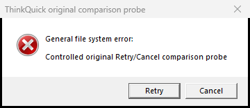
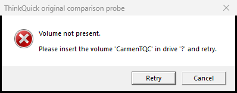
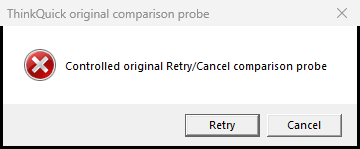

# Original Retry/Cancel dialog observations and debugger handle correction

Six real original dialog cases qualify twice, with screenshots and actual child
control text retained. The owned host watcher matches the copied executable's
full process image path before reading a dialog or sending its WM_COMMAND button
notification. It never sends desktop keyboard/mouse input. Original MessageBoxA,
original dialog helper0x451550 and application callback0x42db7e execute; no dialog
API return or callback decision is replaced. Each process is terminated/drained
before the next case. The watcher touches only its exact copied probe process.

| Actual dialog path | Retry control4 | Cancel control2 |
| --- | --- | --- |
| Original helper, flags0x8009 | Internal8; stored result word8 | Internal1; stored result word1 |
| Original application callback, category1/policy1 | Callback1 | Callback0 |
| Original application callback, category3/policy1 | Callback1 | Callback0 |

These captures were inspected visually. The callback loads the original EXE's
message resources: category1 shows General file system error; category3 shows the
volume-not-present message and CarmenTQC volume name. Drive '?' reflects absent
fixture device fields; it is not an observed hardware failure. Six screenshots,
button identities/text, complete native receipts, dimensions and individual PNG
hashes are retained. Pixel hashes may vary with button-focus painting; repeated
qualification checks native values and actual control structure/text, not fixed
pixels or fabricated screenshots.

## Explicit initialization boundary

Normal application entry remains withheld. Selected CRT/filesystem/cache boot
uses the documented original synchronous-I/O fallback. A caller-owned manager
shell provides its title string field and global0x49afb0. The window-hook list
and application modal-lock pointer remain null. Original dialog formatting,
resource lookup, MessageBox interaction and result mapping execute with that
bounded fixture context. These observations establish the real callback dialog
branches and result decisions, not normal startup, hook reentrancy, missing-media
recovery or execution of the native file-operation retry loop. Those remaining
paths stay in the Step3 audit. No original file operation is failed artificially
and then presented as an actual hardware failure.

## Debugger transport correction

The first UI diagnostic exposed a host handle-lifetime bug, separate from an
initial GDI signature error. The transport manually closed the hThread received
in CREATE_THREAD_DEBUG_EVENT. Windows closes that debugger-owned handle when
ContinueDebugEvent continues EXIT_THREAD_DEBUG_EVENT. An early manual close lets
the automatic close hit a reused host handle; the concurrent UI watcher exposed
an invalid Python semaphore. The manual close is removed. Debugger file handles
remain explicitly closed; separately opened fault-thread handles remain owned
by the transport and are closed after context capture. See Microsoft's
[ContinueDebugEvent contract](https://learn.microsoft.com/en-us/windows/win32/api/debugapi/nf-debugapi-continuedebugevent)
and [WaitForDebugEvent ownership](https://learn.microsoft.com/en-us/windows/win32/api/debugapi/nf-debugapi-waitfordebugevent).

A meaningful new native guard creates two target threads, waits for normal exits
and checks that five independently owned host events survive two observed thread
exit events. The prior deliberate child-UD2 guard still verifies actual fault
thread/EIP attribution. All245 existing original-side cases replay under the
corrected transport:60 VM,30 extended values,6 disk,7 resident/destructor/link,
4 eviction,49 component,16 storage,37 OS-policy,5 unload fixtures and31 leaf cases.
Each suite retains its scope; adding counts does not make fixtures real cache
or turn original-only cases into CE pairs. Six real UI cases are additional.
Earlier UI runs01–03 remain diagnostic and are excluded. No engine changes occur.

Reproduce probe_mohawk_v5_os_ui.py --original <pinned EXE> --root <new owned root>.
This opt-in native probe briefly creates real original dialogs, captures each
owned window through PrintWindow and responds to the observed Retry/Cancel
controls. Run test_mohawk_v5_debug_handles.py and test_mohawk_v5_fault_thread.py
with the same original/root arguments in fresh roots for debugger guards.
Source/executable hashes, repeated receipts and regression summaries are in the
JSON companion. Original UI observations do not increase paired totals.

Step3 remains active: native-operation retry/short-I/O, remaining lifecycle/list/
numeric/key, database/selector and applicable CE storage, final aggregate runner
and published-source replay remain. Stop before Step4; PR295 stays a draft.
