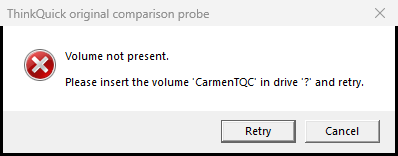

# Original retries, exact I/O and actual dialog decisions

18 original-only cases qualify twice, separating controlled operation failures,
real owned-file I/O and actual application Retry/Cancel. Selected original boot,
manual UI title context and synchronous worker fallback retain their prior
explicit boundaries. No engine changes or normal startup qualification.

## Original retry runner: eight controlled-operation cases

Actual0x456488,0x45641c/0x456411,0x454102 and0x4548ef execute. Original0x4563d1
constructs an operation shell given a fixture virtual method supplying raw21/5/0
and counting attempts. A controlled callback records category/policy and returns
a decision. These are explicit inputs, not attributed native hardware/API errors.

| Scenario | Attempts | Callback calls | Final status |
| --- | ---: | ---: | --- |
| Fail twice, Retry, success | 3 | 2 | 0 |
| Cancel first | 1 | 1 | 0x284c |
| Retry once, then Cancel | 2 | 2 | 0x284c |
| No callback, policy1 | 1 | 0 | 0x284c |
| Negative suppression | 1 | 0 | 0x284c |
| Non-retryable raw5 | 1 | 0 | 0x283c |
| Success first | 1 | 0 | 0 |
| Callback0/policy0, fail twice then succeed | 3 | 2 | 0 |

An eight-attempt guard changes further failures to non-retryable5 and records
overflow; qualified cases never hit it. The synthetic UNC-looking name is only
parsed/looked up in the initialized original in-memory volume list; the fixture
calls no file/network API and never opens that name. An experimental assumption
that initialization leaves the volume list empty was false and is not retained.

## Real application Retry/Cancel driving the runner: three cases

Actual callback0x42db7e, resource dialog and MessageBoxA replace the controlled
decision callback. The owned watcher verifies the copied process's full path,
captures its actual controls and sends the observed button WM_COMMAND.

| Actual button sequence | Attempts | Final status |
| --- | ---: | --- |
| Retry, fixture succeeds next | 2 | 0 |
| Retry, fixture fails again, Cancel | 2 | 0x284c |
| Cancel first | 1 | 0x284c |

Four captured windows cover three cases. The controlled callback counter stays
zero. Raw operation failures remain fixture inputs, not missing physical media.
Title-manager/null-window-hook context follows the prior UI report. This proves
actual original UI decisions reach the operation loop in the controlled context.

## Real original exact-I/O wrappers: seven cases

Original path/open0x45529d, read0x45559b, write0x4554b8 and close0x455369 run on
owned ABC files. Native ReadFile/WriteFile results are not replaced. A Retry
callback verifies when it is not invoked. Every real file closes successfully.

| Flow | Status | Actual bytes | Other observations |
| --- | --- | ---: | --- |
| Read3 | 0 | 3 | Exact ABC |
| Request8 from three-byte file | 0x283f | 3 | ABC prefix; untouched buffer tail |
| Read0 | 0 | 0 | File preserved |
| Read1 after EOF | 0x283f | 0 | Prior buffer preserved |
| Null FILE argument | 0x286f | 0 | Wrapper clears count |
| Write3 through OS read/write handle | 0 | 3 | Exact disk XYZ |
| Write through OS read-only handle | 0x283c | 0 | ABC preserved |

All callback counts are zero. Successful short reads fail the count check
without entering Retry/Cancel. The OS read-only-handle test differs from the
component method named openReadOnly. Partial successful writes are untested;
no disk-full/crash-durability claim is made.

Reproduce probe_mohawk_v5_retry.py, probe_mohawk_v5_short_io.py and opt-in
probe_mohawk_v5_retry_ui.py with --original <pinned CarmenTQ.exe> --root <fresh
owned directory>, separately. The JSON companion retains exact executable/source
identities, complete repeated results, byte/file hashes and UI screenshots/events.
18 original-only cases add no paired CE claim. The bounded OS probe queue now has
mapping/policy, actual runner retry/cancel, real short-read and real dialog evidence;
modal hook reentrancy remains a lifecycle question. Step3 remains active before
Step4; remaining VM/list/mask/key, lifecycle, database/selector/applicable CE
storage and aggregate reproduction remain. PR295 stays an unchanged draft.
